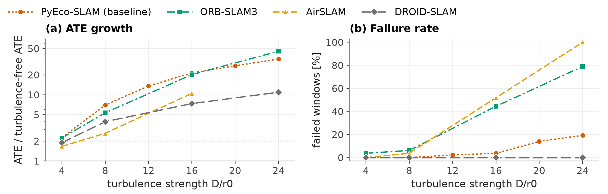
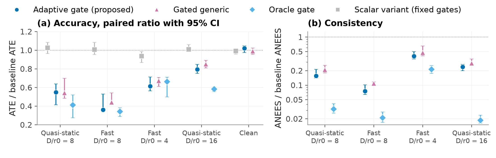

# turb-stereo-vo: Stereo Visual Odometry Under Atmospheric Optical Turbulence

<p align="center">


</p>

> Code, run records, and pre-registration of the paper "Stereo Visual Odometry Under Atmospheric Optical
> Turbulence: Online Image-Motion Estimation and Adaptive Outlier Gating" (Ufuk Asil, OSTIM Technical University).

Look at a distant scene above a hot road and it shimmers. For a camera that navigates, the shimmer is not a
cosmetic problem: every tracked feature wanders by several pixels, differently across the image, and the
odometry starts throwing away correct matches as outliers. This repository measures how much that costs
stereo visual odometry (VO), finds where the loss comes from, and removes most of it with a remedy that reuses
the residuals the odometry already computes.

| **9.03×** | **−64%** | **1.020** | **0.863** |
|:---:|:---:|:---:|:---:|
| ATE of the baseline at D/r0 = 8 relative to clear air (median paired ratio) | median ATE of the adaptive gate against the baseline (fast regime, D/r0 = 8) | ATE ratio in clear air: the gate costs nothing when it is not needed (95% CI up to 1.047) | rank correlation of the online estimate with a scintillometer on real imagery |

- **Simulator.** Anisoplanatic tilt and short-exposure blur from Kolmogorov phase screens, injected after
  rectification, with a quasi-static and a fast temporal regime (`turb/`).
- **Online estimator.** The tilt standard deviation is estimated during flight from the differential motion
  of tracked features, by a structure-function fit, without a reference target (`turb/dimm_v2.py`).
- **Adaptive gate.** The estimate scales the pixel noise and the outlier gates of tracking together
  (`--turb_gate 3`) inside a factor-graph stereo pipeline (PyEco-SLAM).

<p align="center"></p>
<p align="center"><sub><b>Figure 1.</b> EuRoC MH05, frames 502–901, fast regime, D/r0 = 8, seed 3: the window with the largest gain in the confirmatory grid, shown as a selected example. Top: the same left-camera frame without and with turbulence. Bottom: causal trajectories and position error of the baseline and of the adaptive gate. The median gain over the grid is smaller; see Highlights.</sub></p>

| Window (frames) | Baseline | Scalar Variant | **Adaptive Gate** | Oracle Gate | Gate / Baseline |
|:---|---:|---:|---:|---:|---:|
| 102–501 | 0.176 | 0.165 | **0.128** | 0.108 | 0.728 |
| 502–901 | 1.433 | 1.218 | **0.122** | 0.083 | 0.085 |
| 902–1301 | 1.189 | 0.912 | **0.543** | 0.373 | 0.457 |

<p align="center"><sub>ATE [m] of the three windows of the cell of Figure 1. The scalar variant uses the same online estimate without gate scaling; the oracle gate is given the true tilt strength. Cells are examples; the aggregate follows.</sub></p>

## Highlights

Median over 36 units (9 sequences × 4 seeds) of the paired ATE ratio, with 95% bootstrap confidence
intervals; values below 1 favour the first arm. The gated generic arm applies the same gate rule with a scale taken
from the running RMS of the reprojection residuals instead of the turbulence estimate. Both grids were
pre-registered and analysed once.

| Condition | **Adaptive Gate** / Baseline | Gated Generic / Baseline | Adaptive Gate / Gated Generic | Scalar Variant / Baseline | Oracle Gate / Baseline | Position ANEES, Gate / Baseline |
|:---|---:|---:|---:|---:|---:|---:|
| Quasi-static, D/r0 = 8 | **0.549 [0.415, 0.638]** | 0.542 | 0.890 [0.842, 1.001] | 1.026 | 0.412 | 0.156 |
| Quasi-static, D/r0 = 16 | **0.794 [0.752, 0.849]** | 0.849 | 0.953 [0.903, 0.988] | 1.010 | 0.582 | 0.239 |
| Fast, D/r0 = 8 | **0.362 [0.347, 0.529]** | 0.440 | 0.895 [0.824, 0.951] | 1.006 | 0.343 | 0.075 |
| Fast, D/r0 = 4 | **0.613 [0.564, 0.712]** | 0.672 | 0.952 [0.923, 1.023] | 0.937 | 0.662 | 0.401 |
| No turbulence | 1.020 [0.976, 1.047] | 0.989 | 1.019 [0.999, 1.037] | 0.991 | – | 0.683 |

- **Up to 64% lower trajectory error.** The adaptive gate cuts the median ATE to 0.362–0.613 of the baseline
  in the three pre-registered turbulent conditions (Holm-adjusted p ≤ 4.0×10⁻⁹) and improves 35, 36, and 33
  of the 36 units.
- **Free in clear air.** Without turbulence the gate is neutral: 1.020 [0.976, 1.047], inside the
  pre-registered bound of 1.10.
- **The physics adds to the gain.** Against the same gate driven by a generic residual scale, the turbulence
  estimate is 5% to 11% more accurate in three of four conditions and equivalent in the fourth, and its
  position ANEES is 16% to 26% lower in all four.
- **The cause is found, not guessed.** Inflating the noise alone, even with the true turbulence strength,
  leaves the ATE unchanged (ratios 0.94 to 1.03): correct matches are lost at the tracking gates, which are
  tuned for one-pixel noise. Tilt, not blur, carries the loss, and it hits all four tested systems.
- **Checked against real air.** On 119 one-minute recordings over a 724 m path, the unchanged estimator
  follows the scintillometer reading (rank correlation 0.863).

Limitations: the accuracy results come from simulated turbulence on EuRoC and a rendered scene, the online gate
does not reach the oracle gate at D/r0 ≥ 8, and ten pre-registered predictions failed; all of them are reported
in the paper and in `results/`.

## Results

### 1. Degradation of four odometry systems

<p align="center"></p>
<p align="center"><sub><b>Figure 2.</b> (a) Growth of the ATE relative to the turbulence-free run and (b) share of failed windows, against turbulence strength. The studied baseline is PyEco-SLAM; the other systems run on the same degraded images.</sub></p>

| System | D/r0 = 4 | D/r0 = 8 | D/r0 = 16 | D/r0 = 24 | Failed Windows at 16 [%] | Failed Windows at 24 [%] |
|:---|---:|---:|---:|---:|---:|---:|
| PyEco-SLAM (studied baseline) | 2.25 | 6.99 | 21.37 | 34.68 | 3.7 | 19.3 |
| ORB-SLAM3 (stereo) | 2.23 | 5.35 | 20.18 | 45.50 | 44.4 | 79.0 |
| AirSLAM | 1.66 | 2.62 | 10.49 | no valid window | 51.9 | 100.0 |
| DROID-SLAM | 1.89 | 3.92 | 7.37 | 10.93 | 0.0 | 0.0 |

<p align="center"><sub>ATE growth factor. Studied baseline: ratio of level medians over 135 windows; other systems: median paired ratio over the windows in which both runs succeeded (81 windows per level).</sub></p>

### 2. Adaptive gate

<p align="center"></p>
<p align="center"><sub><b>Figure 3.</b> (a) ATE ratio and (b) position ANEES ratio to the baseline, with 95% confidence intervals, in the four turbulent conditions and without turbulence. The gated generic arm uses the same gate rule with a residual-based scale; the scalar variant uses the online noise level with fixed gates; the oracle gate is given the true tilt strength.</sub></p>

### 3. Online estimate on real imagery

<p align="center"></p>
<p align="center"><sub><b>Figure 4.</b> Tilt variance estimated by the unchanged estimator against the scintillometer reading, 119 one-minute records over a 724 m path (data of Saha et al., not redistributed here).</sub></p>

| Criterion (declared before processing) | Value [95% CI] | Outcome |
|:---|---:|:---|
| Rank correlation with scintillometer | 0.863 [0.585, 0.903] | passed |
| Log-log slope | 0.833 [0.665, 0.883] | passed |
| Median ratio, estimated / measured Cn2 | 0.399 [0.366, 0.413] | passed |
| Median R2 of the structure-function fit | 0.615 | failed |

### 4. Ablation: tilt against blur

Share of the ATE increase of the baseline that is reproduced when only one component of the degradation is
applied (45 units). The shares sum to more than one at D/r0 = 16; the effects are sub-additive.

| Level | Share of Tilt Alone | Share of Blur Alone |
|:---|---:|---:|
| D/r0 = 8 | 0.818 | 0.087 |
| D/r0 = 16 | 0.836 | 0.362 |

## Why the numbers can be trusted

- **Written down before the runs.** Hypotheses, metrics, tests, and decision rules were fixed in a
  pre-registration document whose SHA-256 was recorded before the confirmatory runs; each of the seven later
  deviations was dated and hashed before its results existed (`preregistration/`).
- **Failures are kept.** Ten predictions failed, among them the expectation that blur would dominate the loss; they
  are reported in the paper and its supplementary material next to the ones that held.
- **No number is typed by hand.** Every table of this README and every headline number of the paper is
  re-derived from the stored records by a script (see [Reproducing the paper](#reproducing-the-paper)).
- **Every record knows its code.** Each run record carries the fingerprint of the code that produced it
  (`docs/IDENTITY.md`), and the grids added by the deviations were started only after pre-tests that include
  bit-identity checks against the reference runs.

### Protocol

| Item | Setting |
|:---|:---|
| Data | EuRoC MH_01 to MH_05, V1_01, V1_02, V2_01, V2_02; up to three windows of 400 frames per sequence |
| Unit | one (sequence, seed) pair; ATE averaged over the windows of a unit |
| Metric | ATE of the causal trajectory after rigid alignment over the window; position ANEES |
| Turbulence | D = 0.10 m, 550 nm, 5.86 µrad per pixel; quasi-static (coherence time = frame interval) and fast (5 m/s) |
| Statistics | paired median ratio, 10 000 bootstrap resamples, Wilcoxon signed-rank, Holm adjustment, TOST at ±15% |
| Pre-registration | `preregistration/ON_KAYIT_FAZ2.md` with seven dated deviations and a SHA-256 history |

## Installation

```bash
# creates the conda environment `pyeco` (Python 3.12, torch 2.5.1 + CUDA 12.4, gtsam 4.2.1, numpy 1.26.4)
bash install.sh
# machine without a GPU
bash install.sh --cpu
```

Reference machine: Ubuntu 24.04, RTX 3090. The numpy pin matters: the gtsam wheel fails with numpy 2.

## Data

```bash
# EuRoC sequences in ASL format under one root: $SLAM_DATA_ROOT/MH01/mav0/...
export SLAM_DATA_ROOT=/data/sdata
```

EuRoC MAV is distributed by ETH Zurich (Burri et al., 2016) and is not included; Figure 1 shows one frame of
MH_05 for illustration. The real imagery of Saha et al. (2022) and the AirSim scene are not redistributed;
only derived per-minute records and analysis outputs are stored. The learned restoration networks used in
one experiment are not included (no code, no weights).

## Running

```bash
# plan of an experiment without running it
python sapma7_kos.py --kuru
# adaptive-gate confirmatory grid, one part (resumable)
python kapi_dogrula.py --parca II --dokumler DUMP_DIR
# main grid on one GPU: dry check, then start with 10 workers
./faz2_kos.sh kuru
./faz2_kos.sh baslat 10
```

The backend options of the arms are ordinary command-line flags, for example the adaptive gate:
`--turb_cal_factor 1.0 --turb_dimm_sigma_scale 1.0 --turb_gate 3` on the arm `A0C+A3`.
Identifiers, comments, and run logs of the experiment scripts are in Turkish (`kos` = run, `analiz` =
analysis, `kapi` = gate, `hizli` = fast regime, `onarim` = restoration, `sapma` = deviation, `ontest` =
pre-test, `kuru` = dry run).

## Reproducing the paper

```bash
# code fingerprints of both trees
python scripts/verify_identity.py
# headline numbers of the paper against the analysis files
python scripts/check_paper_numbers.py
# tables of this README against the record files
python scripts/readme_tables.py --check
# figures of this README
python scripts/make_readme_figures.py
# decision tables from the stored records (each prints its hypotheses and outcomes)
python -m turb.faz2_analiz
python -m turb.h2_analiz
python hizli_analiz.py
python a3s_analiz.py
python onarim_analiz.py
python kapi_dogrula_analiz.py
```

Every record in `results/` carries the fingerprint of the code that produced it (`docs/IDENTITY.md`).

## Repository layout

| Path | Content |
|:---|:---|
| `turb/` | simulator, online estimator, covariance arms, metrics, runners, analyses |
| `gtsam_backend.py`, `stereo_front_end.py`, `realtime_pipeline.py` | the odometry pipeline (PyEco-SLAM) |
| `kapi_*.py`, `sapma7_*.py`, `hizli_*.py`, `a3s_*.py`, `onarim_*.py` | runners and analyses of the dated deviations |
| `airsim/` | recording and grid scripts of the rendered test bed |
| `results/` | records and analysis outputs of every experiment (`evidence` is a link to it) |
| `preregistration/` | pre-registration document, earlier versions, deviations, hash history, pre-test reports |
| `reference/main_tree/` | the three files that differ in the main tree, and the patch |
| `scripts/` | identity check, number checks, README tables and figures |
| `docs/` | identity, provenance, figures |

## License

MIT for the code of this repository (`LICENSE`). Vendored third-party code keeps its own license (`NOTICE`).

## Contact

Questions, bug reports, and replication attempts are welcome through GitHub issues.

## Citation

```bibtex
@unpublished{asil2026turbvo,
  author = {Asil, Ufuk},
  title  = {Stereo Visual Odometry Under Atmospheric Optical Turbulence:
            Online Image-Motion Estimation and Adaptive Outlier Gating},
  note   = {Manuscript},
  year   = {2026}
}
```
